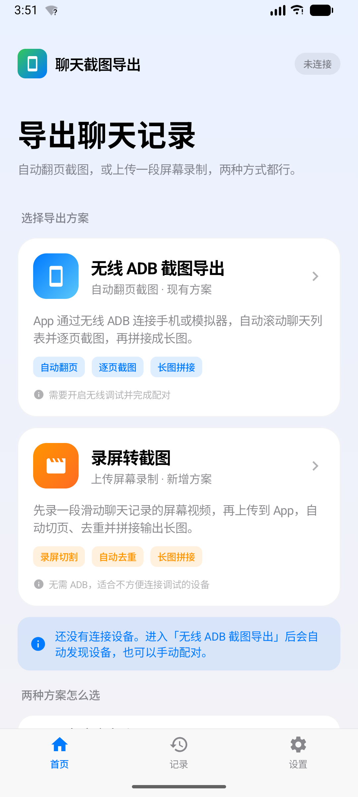
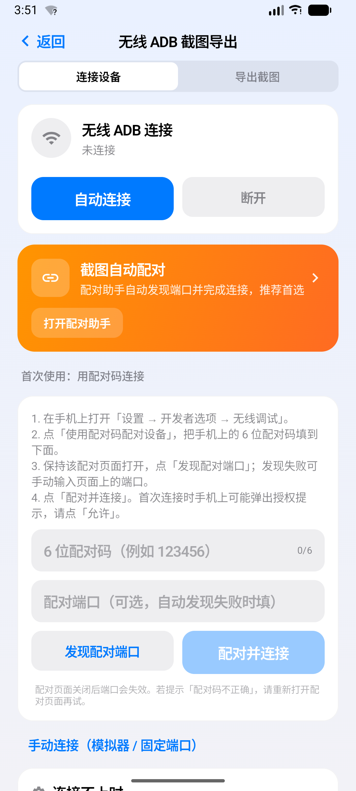
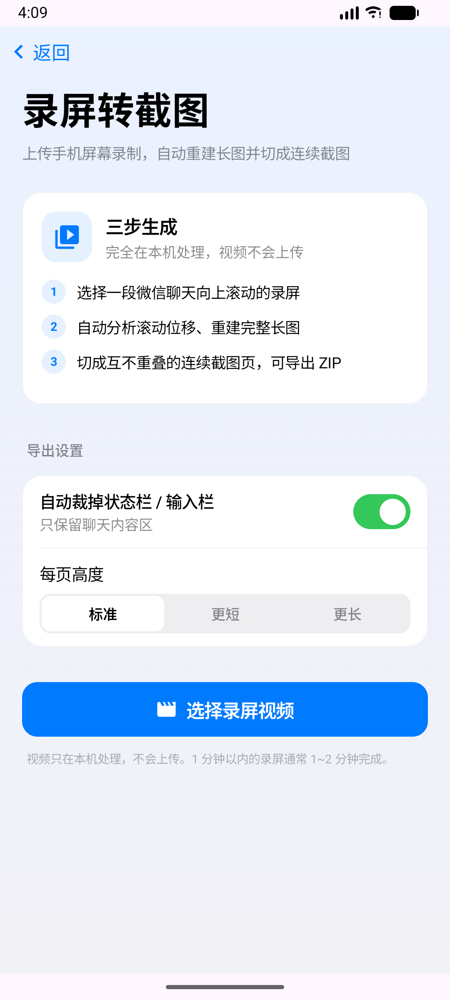
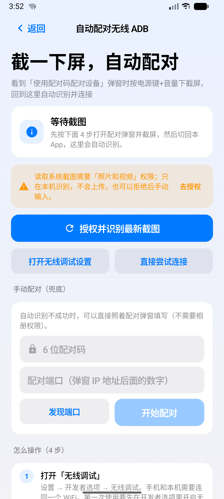
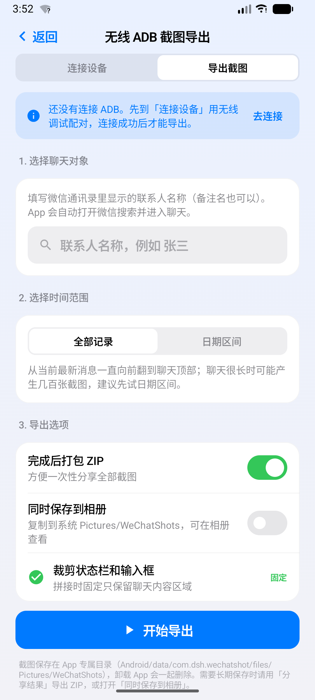
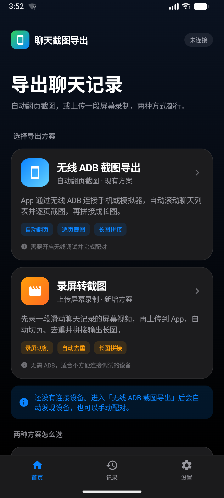
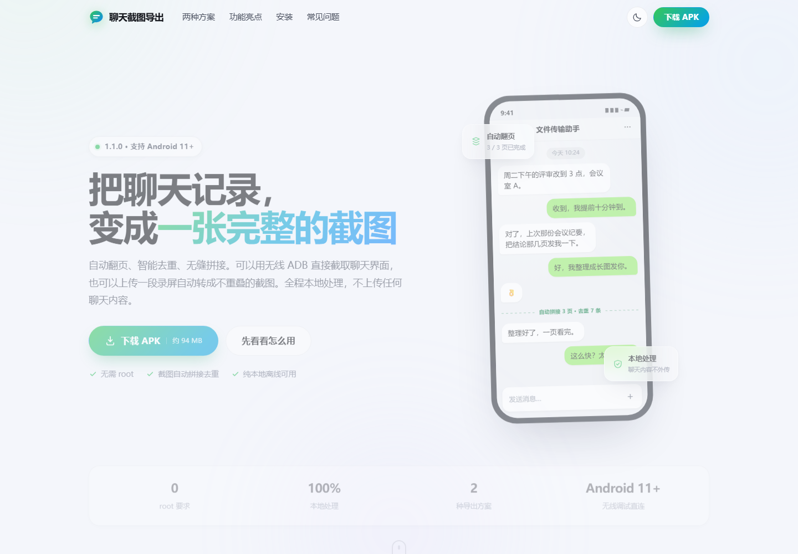

# 聊天截图导出（wechat-shot）

微信聊天记录截图导出工具，包含手机版 App 与 Windows 桌面版：把聊天记录自动整理成「不重叠、不重复、顺序完整」的截图 / 长图。

| 端 | 说明 | 入口 |
| --- | --- | --- |
| Android App「聊天截图导出」 | 无线 ADB 自动翻页截图，或导入录屏自动转截图 | [官网下载](https://qipaclub.top/wechat-shots-app/) |
| Windows「笔录工具箱」 | USB / 无线 ADB 自动滚屏截图（保留少量重叠→自动去重分页），或导入录屏转截图 | `record-toolbox/`（见其 README） |

- Android 官网：<https://qipaclub.top/wechat-shots-app/>
- 最新版本信息：<https://qipaclub.top/wechat-shots-app/version.json>
- Android 应用包名：`com.dsh.wechatshot`，最低 Android 11（API 30）
- Windows 版：Python + WebView2，无需安装运行时（PyInstaller 打包，内置 adb）

## Android 版功能

两种导出方案，输出都是「不重叠、不重复、顺序完整」的截图：

1. **无线 ADB 截图导出**：开启无线调试后自动连接；App 自动翻页截屏，按内容拼接去重，输出完整长图。
   真机上可直接使用「自动配对助手」（无障碍服务）：App 打开系统无线调试页、自动点开配对弹窗、读取配对码与端口并完成连接，无需截图、无需切回。
2. **录屏转截图**：系统录屏聊天过程后导入录屏，App 自动抽帧、按滚动位移拼接并切分成单页截图，无需电脑。

截图、录屏、拼接全部本地处理，不上传聊天内容；无需 root。

## 界面预览

| App 首页 | 无线 ADB 连接 | 录屏转截图 |
| --- | --- | --- |
|  |  |  |

| 截图自动配对 | 导出设置 | 深色模式 |
| --- | --- | --- |
|  |  |  |



更多界面截图见 `docs/screenshots/`。

## 实测数据（开发机 / 模拟器 + 真机）

- 无线 ADB 方案（模拟器，mock 微信，v1.1.3）：21 张保留重叠的原始截图 → 重建长图 31971px → **16 页**，页间按高度零重叠、
  Σ页高 = 长图高；拼接质量检查通过（坏帧 0/20、缺失 0 像素、全局单调性校验通过）。旧版截图重叠更大，同内容为 31 张 → 31979px → 16 页。
  另有页级 seam 质量门：一旦检测到相邻页内容重复（≥240 行连续相同且跨 ≥2 个消息块）自动回退为原始截图页并告警。
- 无线 ADB 方案（真机 OnePlus Ace 6T / ColorOS / Android 17，v1.1.2）：无障碍自动配对 → TLS 连接 → 自动打开微信
  「文件传输助手」→ 翻页截图 → 拼接切页端到端跑通。日期区间 11-16~11-27：2 张原始截图 → 长图 3936px → **2 页**，
  质量检查通过（最长相同行段 27 行）；更大区间 11-10~11-27：10 张原始截图 → 重建 8 页，但相邻页检测到 462 行
  跨 2 个消息块的重复内容（该会话含多张相同/相似图片消息，属对齐歧义），按质量门自动回退为 10 张原始截图并告警。
- 录屏转截图：网页版样片 `input.mp4`（720×1584，23.8s）→ **124 页**（网页版 129 页，-3.9%），内容总高 160234px，
  页间零重叠；模拟器为软件解码，端到端 679.5s，桌面 Chrome 网页版约 49s。
  旗舰真机（硬件解码）预计 30~60s，与网页版同量级甚至更快，待真机实测确认。
- 单元测试：JVM 单测 66 个（拼接规划/页级 seam/全局单调性校验/配对码解析/录屏数学/真机配对截图解析）全绿。

## 已知限制

- 真机自动配对需要开启一次「自动配对助手」（系统无障碍权限，只读取设置界面文字、不上传）。ColorOS/澎湃等系统
  切走应用即关闭配对弹窗，因此截图识别方案在真机上不可用；不想开无障碍时可用手动输入配对码 + 配对端口。
- 录屏方案要求录屏期间聊天列表持续向上滚动；没有滚动或滚动过快（丢帧段过多）时质量门会提示。
- 真实微信聊天里出现重复图片/长图消息时，拼接对齐可能歧义并触发 seam 回退（输出带重叠原始截图 + 告警），不会丢图；
  拼接后的全局单调性校验也会拒绝「位移折返/步长异常」的结果并回退原始截图，不会输出内容错位的长图。

## 目录结构

```
wechat-shots-android/   Android App 源码（Kotlin + Compose）
  app/                  主模块
  mockwechat/           模拟微信测试 App
  dist/                 构建产物 APK
  README.md             App 构建 / 使用说明
website/               官网静态站点（无外部 CDN，系统字体 + 内联 SVG）
  index.html
  styles.css
  app.js
  favicon.svg
  version.json         版本信息模板（发布时由 release_bt.py 写入服务器）
record-toolbox/        Windows 桌面版「笔录工具箱」（Python + WebView2 + 原生前端）
  app/                 Python 后端（HTTP 服务、ADB 客户端、导出 API）
  web/                 前端（iOS 风格界面 + 拼接引擎 + 录屏/截图方案）
  docs/                契约、界面截图
  tests/               拼接引擎 Node 单测（29 个）
  tools/               图标生成、打包、E2E（Edge CDP）
tools/
  release_bt.py         发布 APK + version.json 到宝塔服务器（分片上传 + 公网校验）
  deploy_site_bt.py     部署 website/ 静态文件到服务器
  agent_build.ps1       带全局构建锁的 Gradle 构建入口
wechat-shots/           旧网页版工具（归档，不再更新）
```

## 构建 App

```powershell
powershell -NoProfile -ExecutionPolicy Bypass -File tools\agent_build.ps1 -Task compile
powershell -NoProfile -ExecutionPolicy Bypass -File tools\agent_build.ps1 -Task assemble
```

产物在 `wechat-shots-android/dist/`。

## 发布新版本

1. 升级 `wechat-shots-android/app/build.gradle.kts` 中的 `versionCode` / `versionName`。
2. 构建 release APK。
3. 上传 APK 并写 version.json：

```bash
python tools/release_bt.py \
  --apk wechat-shots-android/dist/wechat-shots-1.1.3-release.apk \
  --version 1.1.3 --code 6 \
  --notes "新增 xxx
修复 yyy"
```

脚本会：
- 用宝塔 API 的 `upload` 分片接口把 APK 上传到 `C:/wwwroot/qipaclub.top/wechat-shots-app/`（8MB 分片、断点续传、失败重试）；
- 写入 `version.json`（versionCode / versionName / apk / minSdk / notes / publishedAt / size / sha256）；
- 校验公网 `HEAD APK` 返回 200 且 `Content-Length` 与本地文件一致，`version.json` 返回 200 且 JSON 字段正确。

> 为什么不用 `files/UploadFile`：宝塔 Windows 面板 8.2.0 的 multipart 上传接口在 API Token
> 调用下会返回 385 字节的「入口校验失败」页面，改用面板前端的分片接口
> `POST /files?action=upload`（urlencoded + base64 分片，追加写入 `.upload.tmp` 后改名）。

## 部署官网

```bash
python tools/deploy_site_bt.py
```

按 `website/` 下的文件逐个写入服务器（`CreateFile` + `SaveFileBody`，UTF-8），
默认跳过 `version.json`（由发布脚本写），并清理历史探测遗留文件；
最后用公网请求校验首页 / CSS / JS / favicon 状态码与关键内容。

## App 内更新

`app/src/main/java/com/dsh/wechatshot/update/UpdateGate.kt` 在启动时请求
`version.json`（5 秒超时、失败静默），当远端 `versionCode` 大于当前
`BuildConfig.VERSION_CODE` 时弹窗展示更新说明，下载 APK 到
`cacheDir/update/update.apk`，再通过 FileProvider 交给系统安装器
（`application/vnd.android.package-archive`）；未授予「安装未知来源应用」时引导去设置授权。

## 服务器

- 宝塔面板：<http://43.142.178.233:8888>（API 密钥见内部文档）
- 站点根目录：`C:/wwwroot/qipaclub.top`，本站目录 `wechat-shots-app/`
- 发布脚本通过环境变量覆盖配置：`BT_PANEL_BASE` / `BT_API_KEY` / `BT_PUBLIC_BASE` / `BT_SERVER_DIR`。
